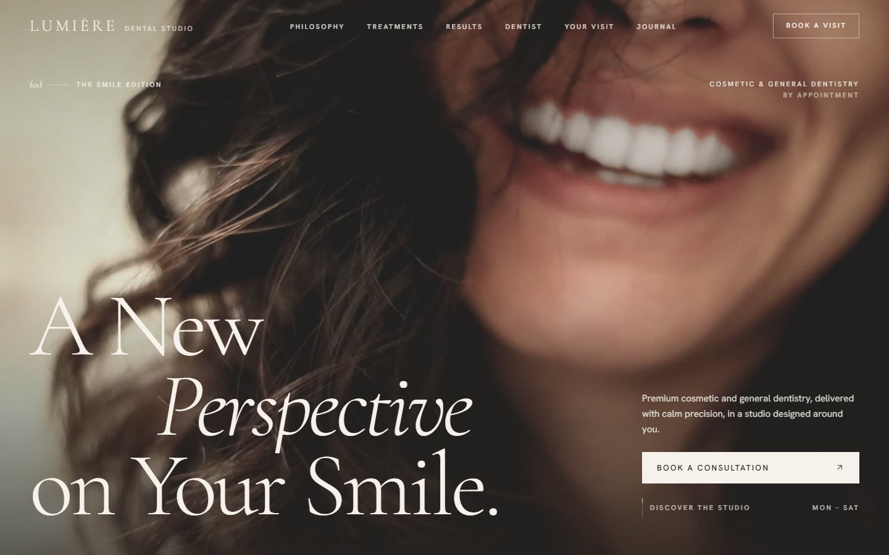
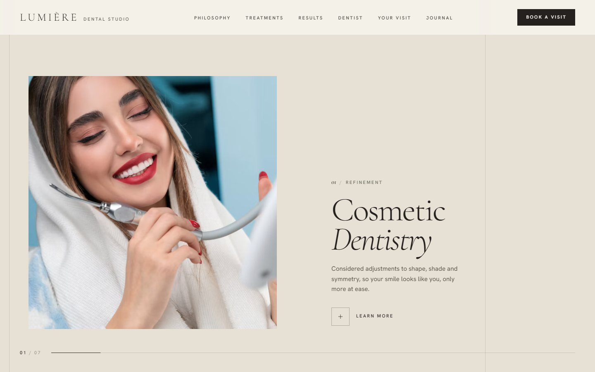
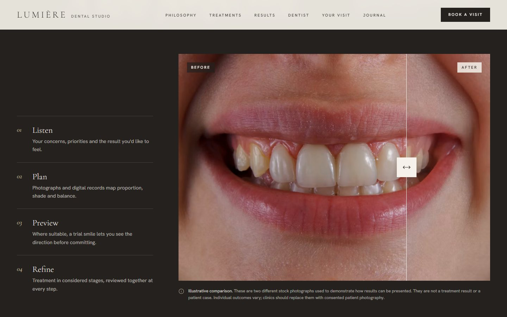
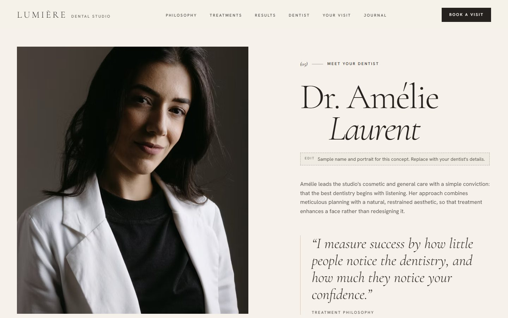
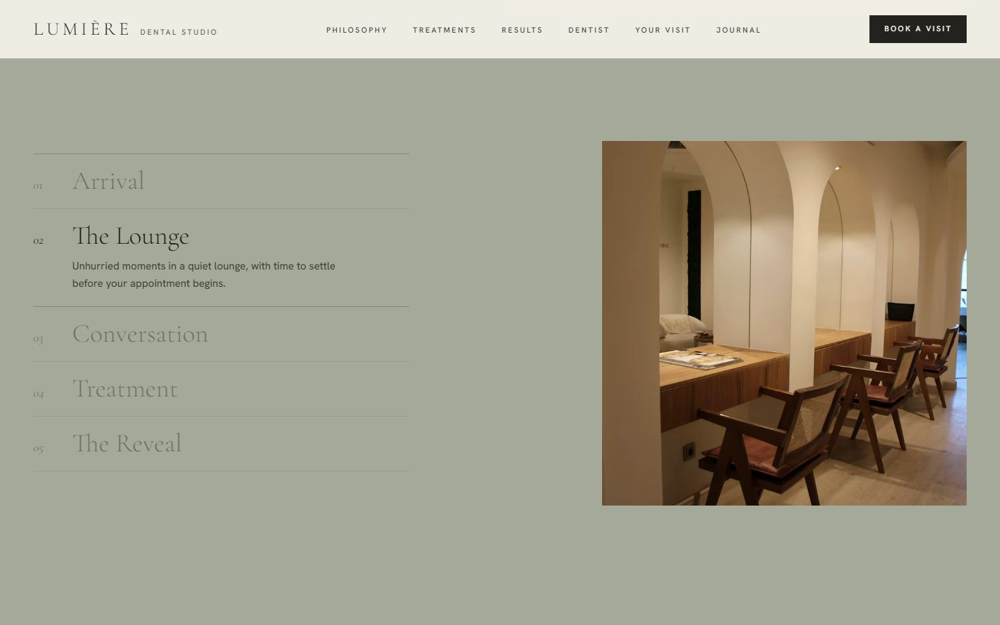
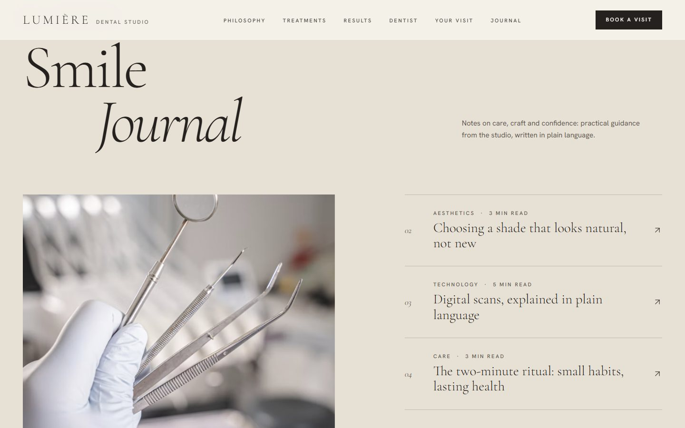
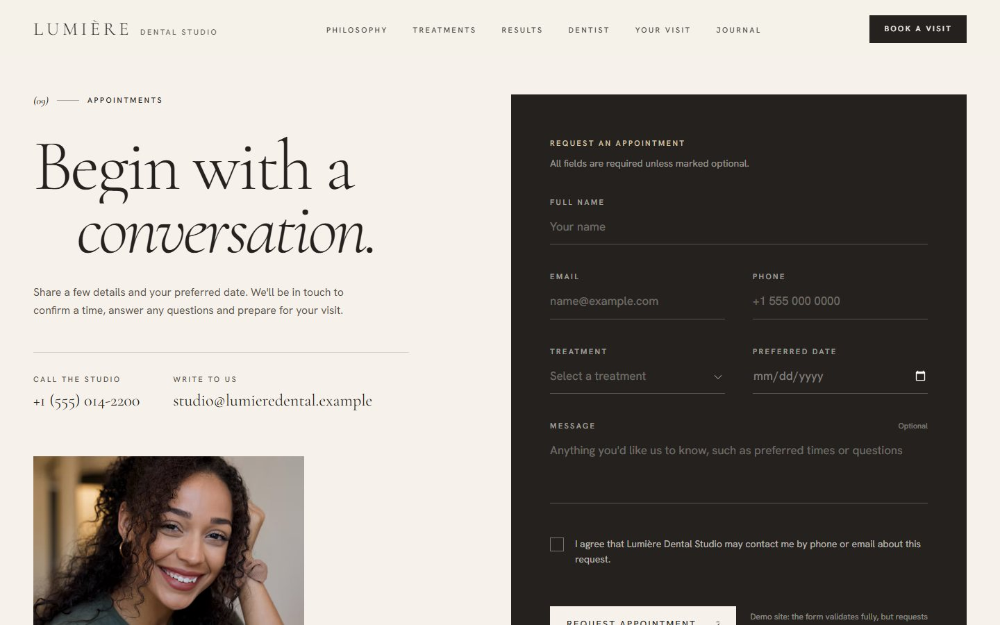
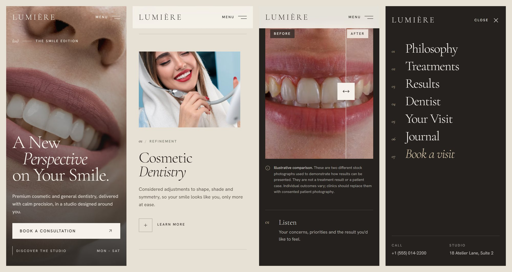

# Lumière Dental Studio

**A New Perspective on Your Smile.**

An editorial, luxury website concept for a premium cosmetic and general dental clinic. It's built to feel like a beauty campaign rather than a medical template: warm neutral palette, oversized serif typography, real photography and cinematic GSAP motion.

**Live demo:** https://usman552.github.io/dental-studio/



## Features

- **Immersive hero.** A full-screen smile photograph with a clip-path reveal, staggered headline lines and a scroll-out parallax. Phones get their own portrait image and composition.
- **Signature Treatments.** On desktop, a pinned horizontal story with seven panels, each in a different layout, plus a live counter and progress line. On mobile it becomes an editorial vertical stack.
- **Treatment drawers.** "Learn more" opens an accessible side panel covering what each treatment involves, who it's often considered for and what to expect. Its button pre-selects that treatment in the booking form.
- **Before/after slider.** Drag it with mouse, touch or pen, or use the keyboard (arrows, Page Up/Down, Home/End). Screen readers get proper slider semantics.
- **Meet Your Dentist.** A sticky portrait with a treatment philosophy, plus clearly marked placeholders for qualifications, experience and registration.
- **Your Visit.** A sticky step-by-step narrative that tracks the clinic photography as you scroll.
- **Patient Stories.** A typographic carousel with swipe support, clearly labelled as demonstration content.
- **Smile Journal.** A featured article and an index with a cursor-following image preview. Articles open in a reading drawer.
- **Appointment booking.** Name, email, phone, treatment, date, message and consent fields. Errors appear inline, focus moves to the first problem, and there are loading, success and error states. The same validation runs on the server.
- **Motion.** GSAP and ScrollTrigger with Lenis smooth scrolling. Elements reveal through data attributes, and all animations are cleaned up via `gsap.context` and `matchMedia`.
- **Accessibility.**
  - Skip link and keyboard-operable everything.
  - Native `<dialog>` drawers and mobile menu, which provide focus trapping and Escape to close.
  - `prefers-reduced-motion` support: everything is visible, with no pinning and no smooth scroll.
- **Responsive.** Designed separately for phone, tablet and desktop, not just scaled down.

## Screenshots

| | |
|---|---|
|  |  |
|  |  |
|  |  |

**Mobile**



## Tech stack

- [Next.js 16](https://nextjs.org) (App Router) and React 19
- TypeScript
- Tailwind CSS 4
- [GSAP](https://gsap.com) with ScrollTrigger and `@gsap/react`
- [Lenis](https://lenis.darkroom.engineering) smooth scrolling
- [Lucide](https://lucide.dev) icons
- Cormorant Garamond and Hanken Grotesk via `next/font`

## Getting started

```bash
npm install
npm run dev        # http://localhost:3000
npm run build      # production build, including the /api/appointment endpoint
```

### GitHub Pages build

```bash
GITHUB_PAGES=true npm run build   # static export to ./out, served under /dental-studio
```

Pushing to `main` deploys automatically via [.github/workflows/deploy-pages.yml](.github/workflows/deploy-pages.yml).

GitHub Pages is static hosting, so this build leaves out the API route. On the Pages site the booking form validates fully and shows its success state, but nothing is sent, and the form says so. A normal server deployment (for example on Vercel) uses the real endpoint in [src/app/api/appointment/route.ts](src/app/api/appointment/route.ts).

## Customising for a clinic

| What | Where |
|---|---|
| Photography and alt text | [src/lib/images.ts](src/lib/images.ts) |
| Clinic details, hours, navigation, treatments, visit steps, testimonials, journal articles | [src/lib/content.ts](src/lib/content.ts) |
| Form rules and treatment options | [src/lib/validation.ts](src/lib/validation.ts) |
| Colours and fonts | [src/app/globals.css](src/app/globals.css), [src/app/layout.tsx](src/app/layout.tsx) |
| Sending booking requests (email or practice system) | the marked integration point in [src/app/api/appointment/route.ts](src/app/api/appointment/route.ts) |

## Project structure

```
src/
  app/                 layout, page, global styles, API route
  components/
    layout/            Header, MobileMenu, Footer, SmoothScroll, RevealController, CursorLabel
    sections/          Hero, Introduction, Treatments, Transformation, Dentist, Visit, Stories, Journal, Appointment
    ui/                Button, ScrollLink, Drawer, CompareSlider, EditorialImage, SectionLabel
  lib/                 content, images, validation, GSAP setup, image loader
```

## Content notice

This is a **concept site**. Before a real clinic uses it:

- The clinic name, address, phone (a fictional 555 number), email, the dentist's name and the testimonials are **sample content**. The testimonials are labelled on the page as demonstration copy, not real reviews.
- The before/after slider uses **two different stock photographs** to show how results could be presented. It is not a treatment result. Replace it with consented patient photography.
- Journal articles are general information, not medical advice.

Photography is from [Unsplash](https://unsplash.com) under the [Unsplash License](https://unsplash.com/license).
